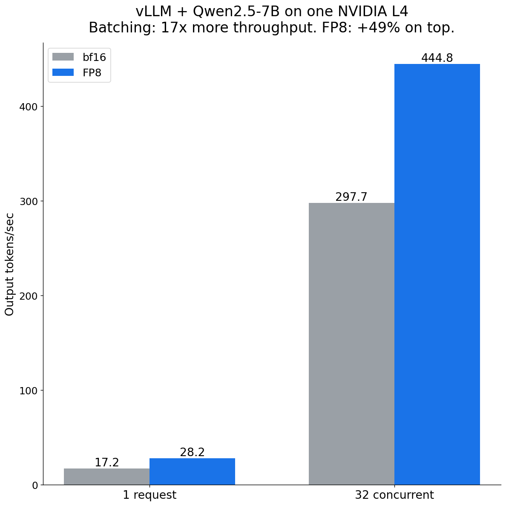

# DocumentSync AI: RAG-Powered Document Q&A, Served with vLLM on GKE

A Retrieval-Augmented Generation (RAG) pipeline for semantic document Q&A. Upload any PDF and ask questions: the system retrieves the most relevant chunks and generates grounded, citation-aware answers.

The LLM is self-hosted with **vLLM on Google Kubernetes Engine (NVIDIA L4 GPU)** and benchmarked for throughput, latency, prefix caching, and FP8 quantization. Full write-up: [`benchmarks/RESULTS.md`](benchmarks/RESULTS.md).

---

## Serving highlights

| Result | Measured |
|---|---|
| Throughput scaling, 1 to 32 concurrent requests (continuous batching) | **17x** (17 to 298 tok/s) |
| Prefix caching, p95 TTFT at 32 concurrent (768-token shared prefix) | **67% lower** (7.3 s to 2.4 s) |
| FP8 vs bf16 throughput at 32 concurrent | **+49%** (298 to 445 tok/s) |
| FP8 vs bf16 end-to-end RAG latency, p95 | **38% lower** (4.36 s to 2.71 s), same 17/20 accuracy |
| Retrieval latency after caching the embedding model, p50 | **1.04 s to 9 ms** |



---

## Architecture

### Pipeline

```
PDF Upload
    │
    ▼
┌─────────────────────────────────────────┐
│           INGESTION LAYER               │
│  pdfplumber → text cleaning → chunking  │
│  4 strategies: fixed 256/512/1024       │
│  + sentence-aware (NLTK)                │
└──────────────────┬──────────────────────┘
                   │
┌──────────────────▼──────────────────────┐
│           EMBEDDING LAYER               │
│  all-MiniLM-L6-v2 (sentence-transformers│
│  384-dim vectors, cached in memory)     │
│  ChromaDB vector store (cosine)         │
└──────────────────┬──────────────────────┘
                   │
┌──────────────────▼──────────────────────┐
│           RETRIEVAL LAYER               │
│  Cosine similarity search               │
│  Tunable: top-k, similarity threshold   │
└──────────────────┬──────────────────────┘
                   │
┌──────────────────▼──────────────────────┐
│           GENERATION LAYER              │
│  Grounded prompt → OpenAI-compatible    │
│  client (vLLM in cluster, Groq locally) │
│  Backend chosen by env vars             │
└──────────────────┬──────────────────────┘
                   │
┌──────────────────▼──────────────────────┐
│           EVALUATION HARNESS            │
│  RAGAS: faithfulness, answer relevancy, │
│  context precision, context recall      │
│  + end-to-end latency benchmark         │
└──────────────────┬──────────────────────┘
                   │
┌──────────────────▼──────────────────────┐
│           STREAMLIT UI                  │
│  PDF upload → query → answer + sources  │
└─────────────────────────────────────────┘
```

### Deployment on GKE

```
                    Internet
                       │
              ┌────────▼────────┐
              │  LoadBalancer   │  public IP, port 80
              │ Service docsync │  sessionAffinity: ClientIP
              └────────┬────────┘
                       │
┌──────────────────────┼─────────────── GKE cluster (us-central1-a) ──┐
│                      │                                              │
│  CPU node pool (e2-standard-4)       GPU node pool (g2-standard-8)  │
│  ┌──────────────────────────┐        ┌──────────────────────────┐   │
│  │ docsync Deployment       │        │ vllm Deployment          │   │
│  │ Streamlit + RAG pipeline │ HTTP   │ vLLM 0.31.0              │   │
│  │ image: app:v2            │───────▶│ Qwen2.5-7B-Instruct      │   │
│  │ HPA: 1 to 3 pods @70% CPU│ vllm:  │ 1x NVIDIA L4 (24 GB)     │   │
│  └──────────────────────────┘ 8000   │ ClusterIP (internal only)│   │
│                                      └──────────────────────────┘   │
│                                      taint nvidia.com/gpu keeps     │
│                                      non-GPU pods off this node     │
└─────────────────────────────────────────────────────────────────────┘
```

---

## Tech Stack

| Layer | Tool |
|---|---|
| PDF parsing | pdfplumber |
| ArXiv ingestion | arxiv Python library |
| Text chunking | LangChain RecursiveCharacterTextSplitter + NLTK |
| Embeddings | sentence-transformers (all-MiniLM-L6-v2) |
| Vector store | ChromaDB (persistent, cosine similarity) |
| Orchestration | LangChain |
| LLM serving (cluster) | vLLM 0.31.0, Qwen2.5-7B-Instruct (bf16 and FP8) on NVIDIA L4 |
| LLM (local dev) | Groq, via the same OpenAI-compatible client |
| Q&A generation for eval | Groq |
| Evaluation | RAGAS + custom end-to-end latency benchmark |
| Containers and infra | Docker, Artifact Registry, GKE, Kubernetes (Deployments, Services, HPA) |
| UI | Streamlit |

---

## Evaluation Results

### Chunking strategies (RAGAS)

Evaluated 4 chunking strategies using RAGAS metrics across 30 sampled Q&A pairs per strategy (120 LLM-as-judge calls each), with a separate judge LLM to avoid token budget conflicts.

| Strategy | Faithfulness | Answer Relevancy | Context Precision | Context Recall |
|---|---|---|---|---|
| fixed_256 | 0.358 | 0.226 | 0.133 | 0.069 |
| fixed_512 | 0.238 | 0.179 | 0.083 | 0.130 |
| **fixed_1024** | **0.336** | **0.232** | **0.212** | **0.252** |
| sentence | 0.306 | 0.154 | 0.077 | 0.086 |

**fixed_1024 wins on context precision and recall.** Larger chunks preserve more context, which improves retrieval quality. The Streamlit UI uses fixed_1024 as the default strategy.

### Serving benchmarks (vLLM on NVIDIA L4)

Concurrency sweep, bf16, 1,024 input / 256 output tokens:

| Concurrency | Output tok/s | TTFT p50 / p95 | TPOT p50 |
|---|---|---|---|
| 1 | 17.2 | 304 / 310 ms | 57 ms |
| 8 | 115.5 | 977 / 2,004 ms | 66 ms |
| 32 | 297.7 | 1,938 / 7,314 ms | 99 ms |

End-to-end RAG, 20 real questions on "Attention Is All You Need":

| Configuration | Total p50 | Total p95 | Correct |
|---|---|---|---|
| bf16 | 1.59 s | 4.36 s | 17/20 |
| FP8 | 1.00 s | 2.71 s | 17/20 |

Prefix caching, FP8 memory trade-offs, methodology, recommendations, and limitations are in [`benchmarks/RESULTS.md`](benchmarks/RESULTS.md).

---

## Project Structure

```
documentsync-ai/
│
├── app/
│   └── streamlit_app.py        # Streamlit UI
│
├── src/
│   ├── ingestion/              # ArXiv fetch, pdfplumber parse, cleaning, 4 chunkers
│   ├── embedding/
│   │   └── embedder.py         # sentence-transformers (cached) + ChromaDB
│   ├── retrieval/
│   │   └── retriever.py        # cosine similarity search
│   ├── generation/
│   │   └── generator.py        # OpenAI-compatible LLM client + retry logic
│   └── evaluation/             # Q&A generation + RAGAS runner
│
├── benchmarks/
│   ├── e2e.py                  # end-to-end RAG latency + quality benchmark
│   ├── RESULTS.md              # serving benchmark write-up
│   └── results/                # raw JSON results (local + GKE)
│
├── k8s/
│   ├── vllm.yaml               # vLLM Deployment + internal Service (GPU)
│   └── docsync.yaml            # app Deployment + LoadBalancer + HPA
│
├── eval/                       # RAGAS Q&A pairs and results
├── Dockerfile                  # CPU-only torch, embedding model baked in
├── config.py                   # all tunable parameters + LLM backend env vars
├── run_pipeline.py             # end-to-end pipeline runner
└── requirements.txt
```

---

## Setup (local)

**Prerequisites:** Python 3.11

```
git clone https://github.com/ana-lan/DocumentSyncAI-RAG-based-QA-for-Documents
cd DocumentSyncAI-RAG-based-QA-for-Documents

python3.11 -m venv venv
source venv/bin/activate

pip install -r requirements.txt
```

**Environment variables:** copy `.env.example` to `.env` and fill in:

```
GROQ_API_KEY=your_groq_api_key          # local LLM backend + Q&A generation
GROQ_JUDGE_API_KEY=your_second_groq_key # RAGAS evaluation judge
```

The LLM backend is set with three optional variables; the defaults point to Groq:

```
LLM_BASE_URL=https://api.groq.com/openai/v1
LLM_MODEL=qwen/qwen3.8-27b
LLM_API_KEY=...                         # falls back to GROQ_API_KEY
```

Any OpenAI-compatible server works, including a local or remote vLLM instance (`LLM_BASE_URL=http://<host>:8000/v1`).

---

## Usage

### Run the full pipeline (fetch papers → embed → test query)

```
python run_pipeline.py
```

### Launch the Streamlit UI

```
streamlit run app/streamlit_app.py
```

### Run the evaluation harness

```
python -m src.evaluation.qa_generator   # generate Q&A pairs for all 4 strategies
python -m src.evaluation.evaluator      # run RAGAS eval across all strategies
```

### Run the end-to-end latency benchmark

```
curl -L -o benchmarks/attention.pdf https://arxiv.org/pdf/1706.03762v7
python -m benchmarks.e2e --label local --limit 5 --pause 20
python -m benchmarks.e2e --label retrieval_only --retrieval-only
```

---

## Deploy on GKE with vLLM

Requires a GCP project with billing enabled and L4 GPU quota (`GPUS_ALL_REGIONS` ≥ 1, `NVIDIA_L4_GPUS` in the region).

```bash
# Build and push the app image (--platform matters on Apple Silicon)
gcloud artifacts repositories create docsync --repository-format=docker --location=us-central1
gcloud auth configure-docker us-central1-docker.pkg.dev
docker build --platform linux/amd64 -t us-central1-docker.pkg.dev/<PROJECT_ID>/docsync/app:v2 .
docker push us-central1-docker.pkg.dev/<PROJECT_ID>/docsync/app:v2

# Cluster with a CPU pool, then an L4 GPU pool (GKE installs the NVIDIA driver)
gcloud container clusters create docsync --zone us-central1-a --machine-type e2-standard-4 --num-nodes 1
gcloud container node-pools create gpu-pool --cluster docsync --zone us-central1-a \
  --machine-type g2-standard-8 \
  --accelerator type=nvidia-l4,count=1,gpu-driver-version=latest --num-nodes 1
gcloud container clusters get-credentials docsync --zone us-central1-a

# Deploy
kubectl apply -f k8s/vllm.yaml
kubectl apply -f k8s/docsync.yaml
kubectl get svc docsync        # open http://<EXTERNAL-IP>

# Tear down (the GPU node bills every hour it exists)
gcloud container clusters delete docsync --zone us-central1-a
```

`k8s/vllm.yaml` serves FP8 by default. Remove `--quantization=fp8` for bf16.


**GPU snapshot** (vLLM serving Qwen2.5-7B in bf16, idle between requests, from `nvidia-smi`):

| Metric | Value |
|---|---|
| GPU | NVIDIA L4 (24 GB) |
| Memory used | 19,512 / 23,034 MiB (85%) |
| Model weights | 14.3 GiB |
| KV cache | 3.9 GiB (72,464 tokens) |
| Process | `VLLM::EngineCore` (19,504 MiB) |
| Power | 37 W / 72 W |
| Temperature | 57 °C |
| Driver / CUDA | 580.173 / 13.0 |

---

## Key Design Decisions

**Why 4 chunking strategies?** Chunk size directly affects retrieval quality. Too small (256 characters) and chunks lack context; too large and retrieval becomes imprecise. The eval harness measures this with RAGAS metrics instead of assuming.

**Why LLM-as-judge eval?** RAGAS uses a separate LLM to score faithfulness and relevancy, a common industry approach. Manually annotating 200+ Q&A pairs would introduce human bias and doesn't scale.

**Why a separate judge LLM?** Running generation and evaluation on the same API account causes token budget conflicts. A second Groq account as the judge keeps evaluation runs clean and uninterrupted.

**Why cosine similarity over L2 distance?** ChromaDB defaults to L2 distance. For sentence-transformer embeddings, cosine similarity is the right metric: it measures angular similarity between vectors, which is what the model was trained to optimize.

**Why an OpenAI-compatible client with env-var config?** vLLM, Groq, and most hosted providers speak the same API. One client plus three environment variables lets the same Docker image run against Groq on a laptop and vLLM in the cluster with no code changes, and makes backend comparisons fair.

**Why self-host with vLLM?** PagedAttention and continuous batching let one GPU serve many requests at once. Throughput scaled 17x from 1 to 32 concurrent requests on a single L4, and FP8 added another 49%.

**Why CPU-only torch in the app image?** The app only runs a small embedding model. CPU torch skips about 4 GB of CUDA libraries, keeping the image at 782 MB compressed. The embedding model is baked into the image, so pods are ready in seconds.

**Why `Recreate` and `enableServiceLinks: false` for vLLM?** With one GPU, a rolling update deadlocks: the new pod waits for a GPU the old pod still holds. Separately, Kubernetes injects `VLLM_*` service variables that collide with vLLM's own config and crash it at startup.

---

## Demo

[](assets/demo.png)

Upload any PDF → ask a question → get a grounded answer with source chunks and cosine similarity scores.