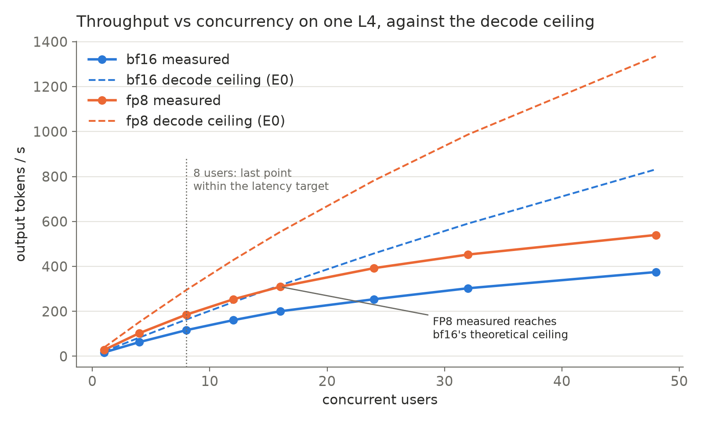
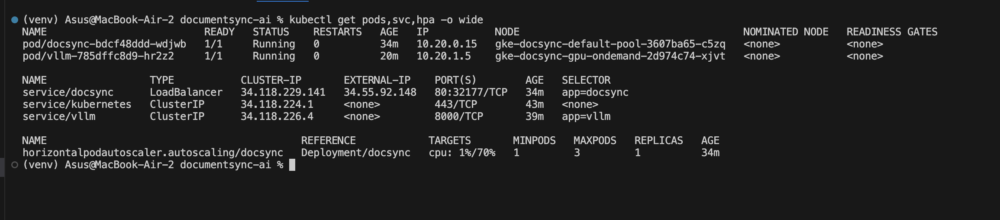
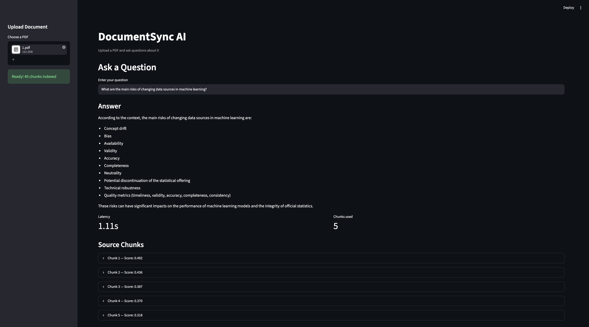

# DocumentSync AI: RAG-Powered Document Q&A, Served with vLLM on GKE

A Retrieval-Augmented Generation (RAG) pipeline for semantic document Q&A. Upload any PDF and ask questions: the system retrieves the most relevant chunks and generates grounded answers that cite the passages they came from.

The LLM is self-hosted with **vLLM on Google Kubernetes Engine (NVIDIA L4 GPU)**. Week 1 benchmarked throughput, latency, prefix caching and FP8 quantization. Week 2 explained those numbers with a hardware model and a GPU profiler, tested FP8's accuracy on a 120-question paired eval, and shipped a prompt layout that makes prefix caching work on real follow-up questions. Full write-up: [`benchmarks/RESULTS.md`](benchmarks/RESULTS.md).

---

## Serving highlights

| Result | Measured |
|---|---|
| Users per L4 within a 2 s p95 time-to-first-token target | **8**, at 185 tok/s with FP8 vs 116 tok/s with bf16 (+59%) |
| Decode speed vs the L4's memory-bandwidth ceiling | **98%** effective bandwidth; GPU busy 99 to 100% (profiler) |
| FP8 vs bf16 accuracy, 120-question paired test | **71 vs 72/120**, McNemar p = 1.0, loss at most ~4.6 points |
| Prompt layout for prefix caching (follow-up questions) | cache hit rate **12% to 26%**, TTFT **8% lower**, same accuracy |
| Retrieval fix (PDF extraction + drop References) | hit@5 **0.80 to 0.95** |
| Speculative decoding (n-gram), one user | **1.5 to 1.9x** faster |
| Throughput scaling, 1 to 32 concurrent requests (continuous batching) | **17x** (17 to 298 tok/s) |



---

## Architecture

### Pipeline

```
PDF Upload
    │
    ▼
┌─────────────────────────────────────────┐
│           INGESTION LAYER               │
│  pdfplumber (x_tolerance 1.5) → drop    │
│  References → cleaning → chunking       │
│  4 strategies: fixed 256/512/1024 chars │
│  + sentence-aware (NLTK)                │
└──────────────────┬──────────────────────┘
                   │
┌──────────────────▼──────────────────────┐
│           EMBEDDING LAYER               │
│  all-MiniLM-L6-v2 (sentence-transformers│
│  384-dim vectors, cached in memory)     │
│  ChromaDB vector store (cosine)         │
└──────────────────┬──────────────────────┘
                   │
┌──────────────────▼──────────────────────┐
│           RETRIEVAL LAYER               │
│  Cosine similarity search               │
│  Tunable: top-k, similarity threshold   │
└──────────────────┬──────────────────────┘
                   │
┌──────────────────▼──────────────────────┐
│           GENERATION LAYER              │
│  Prompt: instructions → chunks in       │
│  document order → question; cites [n]   │
│  OpenAI-compatible client (vLLM in      │
│  cluster, Groq locally), set by env vars│
└──────────────────┬──────────────────────┘
                   │
┌──────────────────▼──────────────────────┐
│           EVALUATION HARNESS            │
│  RAGAS (chunking) + 120-question paired │
│  eval: LLM judge, Wilson CIs, McNemar   │
│  + load tests, profiler, latency bench  │
└──────────────────┬──────────────────────┘
                   │
┌──────────────────▼──────────────────────┐
│           STREAMLIT UI                  │
│  PDF upload → query → answer + sources  │
└─────────────────────────────────────────┘
```

### Deployment on GKE

```
                    Internet
                       │
              ┌────────▼────────┐
              │  LoadBalancer   │  public IP, port 80
              │ Service docsync │  sessionAffinity: ClientIP
              └────────┬────────┘
                       │
┌──────────────────────┼─────────────────────── GKE cluster (zonal) ──┐
│                      │                                              │
│  CPU node pool (e2-standard-4)       GPU node pool (g2-standard-8)  │
│  ┌──────────────────────────┐        ┌──────────────────────────┐   │
│  │ docsync Deployment       │        │ vllm Deployment          │   │
│  │ Streamlit + RAG pipeline │ HTTP   │ vLLM 0.31.0, FP8         │   │
│  │ image: app:v3            │───────▶│ Qwen2.5-7B-Instruct      │   │
│  │ HPA: 1 to 3 pods @70% CPU│ vllm:  │ 1x NVIDIA L4 (24 GB)     │   │
│  └──────────────────────────┘ 8000   │ ClusterIP (internal only)│   │
│                                      │ weights on a 60 GB PVC   │   │
│                                      └──────────────────────────┘   │
│                                      on-demand L4 from a reserved   │
│                                      Compute Engine slot; taint     │
│                                      keeps non-GPU pods off it      │
└─────────────────────────────────────────────────────────────────────┘
```

---

## Tech Stack

| Layer | Tool |
|---|---|
| PDF parsing | pdfplumber |
| ArXiv ingestion | arxiv Python library |
| Text chunking | LangChain RecursiveCharacterTextSplitter + NLTK |
| Embeddings | sentence-transformers (all-MiniLM-L6-v2) |
| Vector store | ChromaDB (persistent, cosine similarity) |
| Orchestration | LangChain |
| LLM serving (cluster) | vLLM 0.31.0, Qwen2.5-7B-Instruct (bf16 and FP8) on NVIDIA L4 |
| LLM (local dev) | Groq, via the same OpenAI-compatible client |
| Q&A generation and judging for eval | Groq |
| Evaluation | RAGAS, a 120-question paired eval (LLM judge, Wilson intervals, exact McNemar), `vllm bench serve`, torch profiler |
| Containers and infra | Docker, Cloud Build, Artifact Registry, GKE, Kubernetes (Deployments, Services, HPA, PVC), Compute Engine reservations |
| UI | Streamlit |

---

## Evaluation Results

### Chunking strategies (RAGAS)

Evaluated 4 chunking strategies using RAGAS metrics across 30 sampled Q&A pairs per strategy (120 LLM-as-judge calls each), with a separate judge LLM to avoid token budget conflicts.

| Strategy | Faithfulness | Answer Relevancy | Context Precision | Context Recall |
|---|---|---|---|---|
| fixed_256 | 0.358 | 0.226 | 0.133 | 0.069 |
| fixed_512 | 0.238 | 0.179 | 0.083 | 0.130 |
| **fixed_1024** | **0.336** | **0.232** | **0.212** | **0.252** |
| sentence | 0.306 | 0.154 | 0.077 | 0.086 |

**fixed_1024 wins on context precision and recall.** Larger chunks preserve more context, which improves retrieval quality. The Streamlit UI uses fixed_1024 as the default strategy.

### Serving capacity (vLLM on one NVIDIA L4)

1,024 input / 256 output tokens; target is p95 time to first token at most 2 s and p95 time per output token at most 100 ms.

| Concurrency | bf16 tok/s | bf16 p95 TTFT | FP8 tok/s | FP8 p95 TTFT |
|---|---|---|---|---|
| 1 | 17.3 | 300 ms | 28.1 | 215 ms |
| **8** | **116.2** | **1,994 ms** | **185.1** | **1,426 ms** |
| 32 | 302.7 | 7,020 ms | 452.7 | 4,957 ms |

Both precisions meet the target up to 8 users; beyond that, time to first token is the limit, not decode speed. At 48 users FP8 still serves 83% of requests within target, bf16 only 5%.

### Answer quality (120 questions over 3 papers)

| | bf16 | FP8 |
|---|---|---|
| Accuracy | 72/120 | 71/120 |
| Accuracy when the right passage was retrieved | 82% | 82% |
| Unanswerable questions correctly refused | 100% | 100% |
| Faithfulness (claims backed by the passages) | 94% | 95% |

Retrieval, not the model, is the accuracy limit: given the right passage, both answer 82% correctly.

The hardware model, profiler breakdown, prompt layout experiment, long context, speculative decoding, methodology and limitations are in [`benchmarks/RESULTS.md`](benchmarks/RESULTS.md).

---

## Project Structure

```
documentsync-ai/
│
├── app/
│   └── streamlit_app.py        # Streamlit UI
│
├── src/
│   ├── ingestion/              # ArXiv fetch, pdfplumber parse, cleaning (References cut), 4 chunkers
│   ├── embedding/
│   │   └── embedder.py         # sentence-transformers (cached) + ChromaDB
│   ├── retrieval/
│   │   └── retriever.py        # cosine similarity search
│   ├── generation/
│   │   └── generator.py        # prompt layouts, citations, OpenAI-compatible client
│   └── evaluation/             # Q&A generation + RAGAS runner
│
├── benchmarks/
│   ├── RESULTS.md              # week 1 and week 2 write-up
│   ├── e2e.py                  # end-to-end RAG latency + retrieval quality (hit@5, MRR)
│   ├── perf_model.py           # L4 hardware model: decode and prefill ceilings
│   ├── chunk_overlap.py        # predicts prefix reuse from chunk IDs, before any GPU time
│   ├── eval_draft.py           # drafts eval questions from paper chunks
│   ├── eval_build.py           # picks, freezes and stores the eval set with its contexts
│   ├── quality_eval.py         # runs frozen questions through a model, records answers + TTFT
│   ├── score_eval.py           # number rules, LLM judge, citations, Wilson, McNemar
│   ├── analyze_week2.py        # all week 2 tables and charts from the raw results
│   └── results/                # raw JSON results (local, GKE week 1, GKE week 2)
│
├── k8s/
│   ├── vllm.yaml, docsync.yaml # week 1 deployment
│   └── week2/                  # pinned vLLM configs (bf16, FP8, FP8 32K, FP8 + speculation), model PVC, app v3
│
├── scripts/gpu/
│   ├── cluster.sh              # image, grab (reserve an L4), up, down, check (nothing left billing)
│   ├── run.sh                  # one command per experiment, results copied back
│   └── bench_in_pod.sh         # load tests and profiling inside the vLLM pod
│
├── eval/                       # RAGAS Q&A pairs, week 2 frozen eval set and judge cache
├── Dockerfile                  # CPU-only torch, embedding model baked in
├── config.py                   # all tunable parameters + LLM backend env vars
├── run_pipeline.py             # end-to-end pipeline runner
└── requirements.txt
```

---

## Setup (local)

**Prerequisites:** Python 3.11

```
git clone https://github.com/ana-lan/DocumentSyncAI-RAG-based-QA-for-Documents
cd DocumentSyncAI-RAG-based-QA-for-Documents

python3.11 -m venv venv
source venv/bin/activate

pip install -r requirements.txt
```

**Environment variables:** copy `.env.example` to `.env` and fill in:

```
GROQ_API_KEY=your_groq_api_key          # local LLM backend + Q&A generation
GROQ_JUDGE_API_KEY=your_second_groq_key # evaluation judge
```

The LLM backend is set with three optional variables; the defaults point to Groq:

```
LLM_BASE_URL=https://api.groq.com/openai/v1
LLM_MODEL=qwen/qwen3.8-27b
LLM_API_KEY=...                         # falls back to GROQ_API_KEY
```

Any OpenAI-compatible server works, including a local or remote vLLM instance (`LLM_BASE_URL=http://<host>:8000/v1`).

The prompt layout is set by `PROMPT_LAYOUT` (`instructions_first`, the default, or `context_first`) and `CHUNK_ORDER` (`position`, the default, or `score`). The defaults are the layout that won the week 2 prefix caching experiment.

---

## Usage

### Run the full pipeline (fetch papers → embed → test query)

```
python run_pipeline.py
```

### Launch the Streamlit UI

```
streamlit run app/streamlit_app.py
```

### Run the evaluation harness

```
python -m src.evaluation.qa_generator   # generate Q&A pairs for all 4 strategies
python -m src.evaluation.evaluator      # run RAGAS eval across all strategies
```

### Run the end-to-end benchmark

```
curl -L -o benchmarks/attention.pdf https://arxiv.org/pdf/1706.03762v7
python -m benchmarks.e2e --label local --limit 5 --pause 20
python -m benchmarks.e2e --label retrieval_only --retrieval-only
```

### Score answers and rebuild the week 2 analysis

```
python -m benchmarks.score_eval <bf16 quality file> <fp8 quality file> --compare
python -m benchmarks.analyze_week2
```

---

## Deploy on GKE with vLLM

Requires a GCP project with billing enabled and L4 GPU quota (`GPUS_ALL_REGIONS` ≥ 1, `NVIDIA_L4_GPUS` in the region).

### Scripted (week 2)

```bash
bash scripts/gpu/cluster.sh image      # build the app image with Cloud Build (no GPU)
bash scripts/gpu/cluster.sh grab       # reserve one L4 in the first zone that has one
bash scripts/gpu/cluster.sh up         # cluster, L4 node pool from the reservation, model disk, app
bash scripts/gpu/run.sh deploy fp8     # start vLLM (also: bf16, fp8-32k, fp8-spec)
bash scripts/gpu/cluster.sh down       # delete everything, including the reservation
bash scripts/gpu/cluster.sh check      # every count should be 0
```

The reservation bills like a running GPU from the moment `grab` succeeds, so run `down` as soon as you're done.

### By hand (week 1)

```bash
# Build and push the app image (--platform matters on Apple Silicon)
gcloud artifacts repositories create docsync --repository-format=docker --location=us-central1
gcloud auth configure-docker us-central1-docker.pkg.dev
docker build --platform linux/amd64 -t us-central1-docker.pkg.dev/<PROJECT_ID>/docsync/app:v2 .
docker push us-central1-docker.pkg.dev/<PROJECT_ID>/docsync/app:v2

# Cluster with a CPU pool, then an L4 GPU pool (GKE installs the NVIDIA driver)
gcloud container clusters create docsync --zone us-central1-a --machine-type e2-standard-4 --num-nodes 1
gcloud container node-pools create gpu-pool --cluster docsync --zone us-central1-a \
  --machine-type g2-standard-8 \
  --accelerator type=nvidia-l4,count=1,gpu-driver-version=latest --num-nodes 1
gcloud container clusters get-credentials docsync --zone us-central1-a

# Deploy
kubectl apply -f k8s/vllm.yaml
kubectl apply -f k8s/docsync.yaml
kubectl get svc docsync        # open http://<EXTERNAL-IP>

# Tear down (the GPU node bills every hour it exists)
gcloud container clusters delete docsync --zone us-central1-a
```

`k8s/vllm.yaml` serves FP8 by default. Remove `--quantization=fp8` for bf16.



**GPU snapshot** (vLLM serving Qwen2.5-7B in bf16, idle between requests, from `nvidia-smi`):

| Metric | Value |
|---|---|
| GPU | NVIDIA L4 (24 GB) |
| Memory used | 19,512 / 23,034 MiB (85%) |
| Model weights | 14.3 GiB |
| KV cache | 3.9 GiB (72,464 tokens) |
| Process | `VLLM::EngineCore` (19,504 MiB) |
| Power | 37 W / 72 W |
| Temperature | 57 °C |
| Driver / CUDA | 580.173 / 13.0 |

---

## Key Design Decisions

**Why 4 chunking strategies?** Chunk size directly affects retrieval quality. Too small (256 characters) and chunks lack context; too large and retrieval becomes imprecise. The eval harness measures this with RAGAS metrics instead of assuming.

**Why LLM-as-judge eval?** An LLM judge scores faithfulness and correctness for free-text answers, a common industry approach. Manually annotating 200+ Q&A pairs would introduce human bias and doesn't scale. Number answers are checked by exact rules instead, so the judge only grades what rules can't.

**Why a separate judge LLM?** Running generation and evaluation on the same API account causes token budget conflicts. A second Groq account as the judge keeps evaluation runs clean and uninterrupted.

**Why cosine similarity over L2 distance?** ChromaDB defaults to L2 distance. For sentence-transformer embeddings, cosine similarity is the right metric: it measures angular similarity between vectors, which is what the model was trained to optimize.

**Why an OpenAI-compatible client with env-var config?** vLLM, Groq, and most hosted providers speak the same API. One client plus three environment variables lets the same Docker image run against Groq on a laptop and vLLM in the cluster with no code changes, and makes backend comparisons fair.

**Why self-host with vLLM?** PagedAttention and continuous batching let one GPU serve many requests at once. Throughput scaled 17x from 1 to 32 concurrent requests on a single L4, and FP8 added another 49%.

**Why FP8?** Decoding on the L4 is limited by how fast weights are read from memory, and FP8 halves most of those bytes. A paired test on 120 questions found 1 disagreement between bf16 and FP8, so the speedup comes with no measurable accuracy cost.

**Why instructions first and chunks in document order?** vLLM's prefix cache only reuses the start of a prompt. With retrieved chunks first in score order, the start changes on every question. With fixed instructions first and chunks sorted by their position in the document, follow-up questions share more of the start: the cache hit rate doubled and time to first token dropped 8%, with the same accuracy.

**Why a Compute Engine reservation for the GPU?** L4s were sold out in every zone. GKE's node pool request kept losing the race for a freed GPU and retried silently for 30+ minutes. A reservation grabs the GPU in whichever zone has one, and the node pool then consumes exactly that reservation.

**Why CPU-only torch in the app image?** The app only runs a small embedding model. CPU torch skips about 4 GB of CUDA libraries, keeping the image at 782 MB compressed. The embedding model is baked into the image, so pods are ready in seconds.

**Why `Recreate` and `enableServiceLinks: false` for vLLM?** With one GPU, a rolling update deadlocks: the new pod waits for a GPU the old pod still holds. Separately, Kubernetes injects `VLLM_*` service variables that collide with vLLM's own config and crash it at startup.

---

## Demo

[](assets/demo.png)

Upload any PDF → ask a question → get a grounded answer with source chunks and cosine similarity scores.