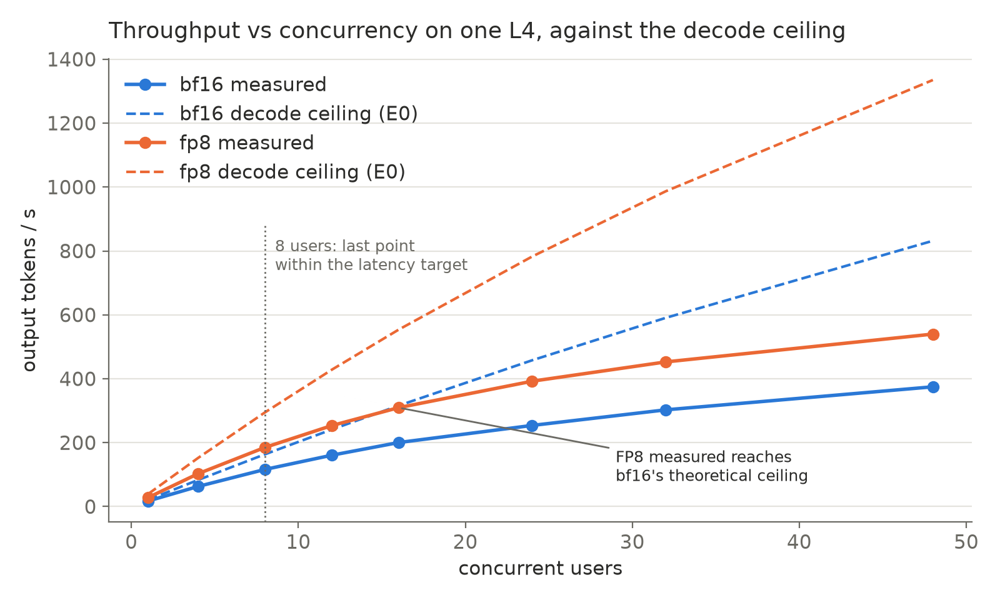
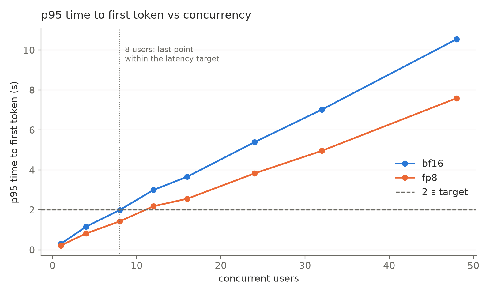

# Serving Benchmarks: vLLM on GKE (NVIDIA L4)

Measured on Oct 10, 2026. Every number below comes from the raw result files in `benchmarks/results/`.

> **Week 2 (Nov 2026)** is at the end: a hardware model and profiler explaining these numbers, a 120-question paired eval of FP8, repeated runs, prompt layout for prefix caching, long context and speculative decoding. It updates the recommendations and limitations below.

## Key results

- **Continuous batching:** output throughput scaled **17x** (17 to 298 tokens/s) from 1 to 32 concurrent requests on a single L4.
- **Prefix caching:** on prompts sharing a 768-token prefix, p95 time-to-first-token dropped **67%** (7.3 s to 2.4 s) and throughput rose **62%** at 32 concurrent requests.
- **FP8 quantization:** weight memory dropped **43%**, KV cache capacity grew **2.5x**, throughput rose **49 to 63%**, and end-to-end RAG p95 latency dropped **38%**, with **no accuracy loss** on a 20-question eval.
- **Pipeline fix:** caching the embedding model cut retrieval p50 latency from **1.04 s to 9 ms**.

## Setup

| Component | Details |
|---|---|
| Cluster | GKE Standard, zonal (us-central1-a), Kubernetes 1.35 |
| CPU node | e2-standard-4 (DocumentSync app) |
| GPU node | g2-standard-8 with 1x NVIDIA L4, 24 GB |
| Inference server | vLLM 0.31.0 (V1 engine, FlashAttention 2, CUDA graphs) |
| Model | Qwen/Qwen2.5-7B-Instruct, max context 8,192, `--gpu-memory-utilization=0.90` |
| App | DocumentSync RAG (pdfplumber, fixed 1,024-character chunks, all-MiniLM-L6-v2, ChromaDB), image `app:v2` |
| Networking | vLLM as internal ClusterIP service; app public via LoadBalancer |
| Autoscaling | HorizontalPodAutoscaler on the app, 1 to 3 replicas at 70% CPU |

The app reaches the LLM through an OpenAI-compatible client configured by environment variables (`LLM_BASE_URL`, `LLM_MODEL`, `LLM_API_KEY`). The same image runs against Groq locally and against vLLM in the cluster with no code changes.

## Methodology

- **Server load tests:** `vllm bench serve` run inside the vLLM pod, so network latency is excluded.
  - Synthetic random prompts, 1,024 input tokens and 256 output tokens (`--ignore-eos` fixes output length).
  - `--max-concurrency` holds a fixed number of requests in flight.
  - Each concurrency level uses a different seed, so later runs cannot hit prefix-cache entries from earlier runs.
- **Prefix caching test:** every prompt shares a 768-token prefix plus 256 unique tokens, with 128 output tokens. ON and OFF used identical prompts (seeds 101 and 132).
- **End-to-end test (`benchmarks/e2e.py`):** 20 factual questions about "Attention Is All You Need", run sequentially through the real pipeline (retrieve, then generate) from inside the app pod.
  - Retrieval and generation are timed separately.
  - 2 warmup questions are excluded from the results.
  - Each answer is saved next to the paper's ground truth for a quality check.
- **Metrics:**
  - TTFT: time to first token
  - TPOT: time per output token, after the first
  - E2E latency: total time per request
  - Output throughput: generated tokens per second across all requests

## 1. Concurrency sweep (bf16)

| Concurrency | Output tok/s | vs c=1 | TTFT p50 / p95 | TPOT p50 | E2E latency p50 / p95 |
|---|---|---|---|---|---|
| 1 | 17.2 | 1x | 304 / 310 ms | 57 ms | 14.9 / 14.9 s |
| 8 | 115.5 | 6.7x | 977 / 2,004 ms | 66 ms | 17.7 / 18.0 s |
| 32 | 297.7 | 17.3x | 1,938 / 7,314 ms | 99 ms | 27.3 / 32.6 s |

**Findings**

- **One request at a time is limited by memory bandwidth.** Every generated token requires reading all 14.3 GB of weights, and the L4 reads about 300 GB/s. That caps a single request at about 17 tokens/s, which is close to the measured value (TPOT 57 ms).
- **Batching amortizes those weight reads across requests.** At c=8, throughput rises 6.7x while per-token latency rises only 15%.
- **At c=32, throughput keeps climbing (17x), but p95 TTFT exceeds 7 s.** New prompts have to wait for prefill time while 31 other requests are decoding. The p95 inter-token latency of 342 ms reflects these prefill interruptions.

## 2. Prefix caching ON vs OFF (bf16)

| Metric | OFF | ON | Change |
|---|---|---|---|
| c=1 TTFT p50 | 298 ms | 110 ms | 63% lower |
| c=1 TTFT p95 | 309 ms | 120 ms | 61% lower |
| c=32 TTFT p50 | 1,914 ms | 1,490 ms | 22% lower |
| c=32 TTFT p95 | 7,302 ms | 2,381 ms | 67% lower |
| c=32 output throughput | 227 tok/s | 367 tok/s | +62% |
| c=32 TPOT p50 | 125 ms | 76 ms | 39% lower |
| c=32 E2E latency p95 | 23.1 s | 11.6 s | 50% lower |

**Findings**

- **With caching, vLLM reuses the stored KV blocks for the shared 768 tokens** and only prefills the 256 unique ones. At c=1 that cuts TTFT by about two thirds.
- **Under load the effect compounds.** Removing repeated prefill frees GPU time for decoding, which lowers tail latency and raises throughput.
- **Decode speed at c=1 is unchanged (57 ms TPOT both ways),** as expected: caching only affects prefill.
- **On DocumentSync's real prompts the effect was within run-to-run noise** (see section 4). Retrieved chunks differ per question, so the only shared prefix is Qwen's roughly 30-token default system prompt.

## 3. FP8 vs bf16

Same workload and seeds as the bf16 sweep. Prefix caching is on (the default) in both.

| Metric | bf16 | FP8 | Change |
|---|---|---|---|
| Weight memory | 14.29 GiB | 8.17 GiB | 43% smaller |
| KV cache capacity | 72,464 tokens | 184,160 tokens | 2.5x |
| Max concurrency at full 8K context | 8.85x | 22.48x | 2.5x |
| c=1 output tok/s | 17.2 | 28.2 | +63% |
| c=1 TPOT p50 | 57 ms | 35 ms | 39% lower |
| c=1 TTFT p50 | 304 ms | 215 ms | 29% lower |
| c=1 E2E latency p50 | 14.9 s | 9.1 s | 39% lower |
| c=32 output tok/s | 297.7 | 444.8 | +49% |
| c=32 TTFT p50 / p95 | 1,938 / 7,314 ms | 1,354 / 5,490 ms | 30% / 25% lower |
| c=32 TPOT p50 | 99 ms | 66 ms | 33% lower |
| c=32 E2E latency p50 / p95 | 27.3 / 32.6 s | 18.4 / 22.3 s | 33% / 32% lower |

**Findings**

- **FP8 attacks the bandwidth bottleneck from section 1 directly.** Fewer bytes per token means faster decoding.
- **The memory it frees becomes KV cache,** so the same GPU holds 2.5x more concurrent context.
- **Weights shrink by 43% rather than 50%** because the embedding and output layers (152K-token vocabulary) stay in bf16.

## 4. End-to-end RAG latency (20 real questions, sequential)

| Configuration | Retrieval p50 | Total p50 | Total p95 | Mean | Correct |
|---|---|---|---|---|---|
| bf16, prefix caching ON | 24 ms | 1.59 s | 4.36 s | 1.92 s | 17/20 |
| bf16, prefix caching OFF | 28 ms | 1.71 s | 5.54 s | 2.12 s | 17/20 |
| FP8, prefix caching ON | 21 ms | **1.00 s** | **2.71 s** | 1.22 s | 17/20 |

**Findings**

- **FP8 lowers real end-to-end latency by about 37%** (p50 and p95) with identical accuracy.
- **Answer length drives latency.** Short factual answers return in about 1 s; long explanations take 3 to 7 s.
- **All 3 misses were retrieval failures in every configuration.** The model answered "I don't know" instead of guessing. The cause is PDF text extraction dropping spaces between words.
- **The caching ON vs OFF gap here is mostly answer-length variance.** The app samples at temperature 0.2, and one long answer moved the p95.

## 5. Retrieval fix

`get_embedding_model()` reloaded the sentence-transformer from disk on every query. The app's latency display only timed the LLM call, so the cost was invisible. Adding `@lru_cache` loads the model once per process.

| Retrieval latency | Before | After |
|---|---|---|
| p50 (local, Apple Silicon) | 1.036 s | 0.009 s |
| p95 (local) | 1.383 s | 0.024 s |
| p50 / p95 (GKE e2-standard-4) | n/a | 20 ms / 22 ms |

Before the fix, retrieval took longer than the LLM call itself on a fast backend. After the fix it is about 1.5% of end-to-end latency.

## Operational notes

- **Spot preemption.** The spot L4 node was reclaimed about 20 minutes after creation. The Deployment rescheduled vLLM automatically, but a cold start on a fresh node (driver install, image pull, weight download, compile) took about 15 minutes. Benchmarks were moved to an on-demand node for a stable window.
- **Autoscaling observed.** Running the e2e benchmark inside the app pod pushed CPU past the 70% target. The HPA scaled the app from 1 to 3 replicas, then back to 1 after its stabilization window.
- **Env var collision.** Kubernetes injects service discovery variables named after each Service. A Service named `vllm` produced `VLLM_PORT=tcp://...`, which vLLM reads as its own config and crashes on. The fix is `enableServiceLinks: false` in the pod spec.
- **Single-GPU rollouts.** The default RollingUpdate starts the new pod before stopping the old one, which deadlocks when there is only one GPU. The fix is `strategy: Recreate`.
- **Startup timing (bf16):**
  - weight download about 90 s
  - model load 125 s
  - torch.compile 27 s
  - about 4 minutes from pod start to ready on a node with the image cached

## Recommendations

1. **Serve with FP8 on the L4.** It gives 49 to 63% higher throughput, 2.5x KV cache capacity, and about 37% lower end-to-end latency, with no accuracy loss on this eval. Validate on a larger eval set before production.
2. **For interactive traffic, target about 8 to 16 concurrent requests per replica** to keep TTFT near 2 s or less, and add replicas beyond that. Push concurrency higher only for offline batch work.
3. **Keep prefix caching on, and design prompts to share prefixes.** Put stable content (system instructions, document summaries, context reused across follow-up questions on the same document) at the start of the prompt.
4. **Use on-demand or reserved GPUs for latency-sensitive serving,** since a preemption costs about 15 minutes of cold start. Spot fits batch jobs that tolerate restarts. A persistent model cache volume would cut restart time.
5. **Fix PDF text extraction and drop the references section before chunking.** For extraction, tune pdfplumber's `x_tolerance` so spaces between words are kept. Both changes target the 3/20 retrieval misses, which are now the main accuracy limit.

## Limitations

- Each configuration was measured in a single run, with no repeated trials or confidence intervals.
- Server load tests use synthetic random prompts rather than real traffic.
- The quality eval is 20 questions on one paper: enough to catch obvious regressions, not to prove equivalence.
- The end-to-end test measures total latency, not TTFT, so small prefill savings are hidden behind generation time.
- Sampling (temperature 0.2) causes small run-to-run variation in answer length.

## Reproduce

Deploy (see `k8s/`):

```bash
kubectl apply -f k8s/vllm.yaml
kubectl apply -f k8s/docsync.yaml
```

`k8s/vllm.yaml` ships with `--quantization=fp8` (the recommended config):
- Remove that line for the bf16 baseline.
- Add `--no-enable-prefix-caching` for the caching-off runs.

Server benchmark, run inside the vLLM pod (`kubectl exec -it deploy/vllm -- bash`):

```bash
# Concurrency sweep: C in {1, 8, 32}, prompts N in {20, 80, 160}, seed = C
vllm bench serve --backend vllm --base-url http://localhost:8000 \
  --model Qwen/Qwen2.5-7B-Instruct \
  --dataset-name random --random-input-len 1024 --random-output-len 256 --ignore-eos \
  --num-prompts $N --max-concurrency $C --seed $C \
  --percentile-metrics ttft,tpot,itl,e2el --metric-percentiles 50,95,99 \
  --save-result --result-dir /tmp/bench --result-filename sweep_c${C}.json

# Prefix caching: C in {1, 32}, N in {20, 160}, seed = 100 + C
vllm bench serve --backend vllm --base-url http://localhost:8000 \
  --model Qwen/Qwen2.5-7B-Instruct \
  --dataset-name random --random-prefix-len 768 --random-input-len 256 --random-output-len 128 --ignore-eos \
  --num-prompts $N --max-concurrency $C --seed $((100+C)) \
  --percentile-metrics ttft,tpot,itl,e2el --metric-percentiles 50,95,99 \
  --save-result --result-dir /tmp/bench --result-filename prefix_on_c${C}.json
```

End-to-end, run from the app pod:

```bash
kubectl exec -it deploy/docsync -- python -m benchmarks.e2e --label vllm_l4
```

Locally, against any OpenAI-compatible backend:

```bash
python -m benchmarks.e2e --label local --limit 5 --pause 20
python -m benchmarks.e2e --label retrieval_only --retrieval-only
```

## Raw data

| Files | Contents |
|---|---|
| `benchmarks/results/gke/vllm_cache_on/sweep_c{1,8,32}.json` | bf16 concurrency sweep |
| `benchmarks/results/gke/vllm_cache_on/prefix_on_c{1,32}.json` | prefix caching ON |
| `benchmarks/results/gke/vllm_cache_off/prefix_off_c{1,32}.json` | prefix caching OFF |
| `benchmarks/results/gke/vllm_fp8/fp8_c{1,32}.json` | FP8 sweep |
| `benchmarks/results/gke/e2e_vllm_l4_{cache_on,cache_off,fp8}.json` | end-to-end runs, with every answer |
| `benchmarks/results/gke/e2e_gke_retrieval.json` | retrieval latency on the GKE node |
| `benchmarks/results/e2e_retrieval_{before,after}_fix.json` | retrieval fix, measured locally |


---

# Week 2: why the numbers look the way they do

Measured in November 2026 on the same setup (vLLM 0.31.0, Qwen2.5-7B-Instruct, one L4 on GKE), with two changes: an on-demand L4 held by a Compute Engine reservation, and model weights on a persistent disk. Week 1 measured what happens. Week 2 explains it with a hardware model and a profiler, tests the claims on a 120-question eval with statistics, and tries three more optimizations. Analysis: `python -m benchmarks.analyze_week2`.

## Key results

- **Capacity:** both bf16 and FP8 meet a p95 TTFT target of 2 s up to **8 concurrent users** per L4. FP8 delivers **59% more throughput** there (185 vs 116 tok/s), and at 48 users it still serves **83%** of requests within target versus **5%** for bf16.
- **Hardware model:** decode runs at **98% of the L4's memory bandwidth** plus about 8.9 ms per step that bandwidth doesn't explain. The profiler is consistent with it: the GPU is busy **99 to 100%** of the time, and weight matmuls take **97%** of kernel time for one user.
- **FP8 accuracy, tested properly:** **72/120 (bf16) vs 71/120 (FP8)**. They disagree on 1 question out of 120 (McNemar p = 1.0); FP8's accuracy loss is at most about 4.6 points (95% upper bound on the share of questions only bf16 gets right).
- **Prompt layout for prefix caching:** putting instructions first and chunks in document order raises the cache hit rate from **12% to 26%** (matching the 26% predicted from chunk IDs alone), cuts TTFT p50 by **8%**, and keeps accuracy (**32/44 vs 33/44**, p = 1.0).
- **Speculative decoding (n-gram):** **1.89x** throughput for one user and **1.17x** at 32 on the synthetic benchmark; **1.52x** decode speed on real RAG answers.

## Setup changes

| Change | Why |
|---|---|
| On-demand L4 via a specific Compute Engine reservation, consumed by the node pool | L4s were stocked out in every zone. A plain node pool request lost the race and retried silently for 30+ minutes; a reservation holds the GPU once granted. |
| Model weights on a 60 GB persistent disk | No re-download after a pod restart |
| Image pinned to `vllm/vllm-openai:v0.31.0`, `VLLM_SERVER_DEV_MODE=1` | Reproducible runs; exposes `/reset_prefix_cache` and the profiler endpoints |
| Retrieval: pdfplumber `x_tolerance=1.5`, References section dropped | Fixes the glued-word extraction behind week 1's retrieval misses (E5) |
| Prompts ask for citations `[n]`, temperature 0 | Citations can be checked; answers are deterministic for paired comparisons |

## Methodology

- **Load tests:** `vllm bench serve` in the pod, random 1,024-token prompts and 256 output tokens, concurrency 1 to 48, a fresh seed per level. c=1, 8 and 32 were each repeated 3 times; every spread was under 1%, and c=1 and c=32 reproduce week 1 within 2%.
- **Latency target:** p95 TTFT at most 2 s and p95 TPOT at most 100 ms. Goodput is the share of requests meeting both (`--goodput`).
- **Eval set (E1):** 120 questions over 3 papers (Attention Is All You Need, RAG, LoRA). Drafted with an LLM from the papers' chunks, then reviewed by hand. 8 question types, including near-identical values (a look-alike wrong number sits nearby) and unanswerable questions.
- **Frozen contexts:** retrieval ran once and the 5 retrieved chunks per question are saved, so every model sees exactly the same passages.
- **Scoring:**
  - Number answers must contain every headline number of the gold answer.
  - Text answers are graded by an LLM judge (qwen/qwen3.8-27b on Groq), which also grades faithfulness (every claim backed by the passages shown).
  - Unanswerable questions count as correct only if the model refuses.
  - A citation counts as correct if the cited passage contains the gold evidence.
  - Judge verdicts are cached by question, answer and the set of passages shown. In E2, 3 answers were word for word the same in A and C and reused a verdict across passage orders; re-judging them in their real order gave the same verdicts (`benchmarks/check_judge_order.py`).
- **Statistics:** Wilson 95% intervals for accuracy; exact McNemar test for paired comparisons (same questions, two configs).
- **E2 sessions:** 44 follow-up questions grouped into sessions on the same paper, run in order as one user. Each variant ran 3 times in interleaved rounds (TTFT spread under 1%), with the prefix cache reset before every run. TTFT is measured client-side from streaming. Accuracy was scored on round 1.

## E3. Capacity under a latency target

| Concurrency | bf16 tok/s | bf16 p95 TTFT | bf16 goodput | FP8 tok/s | FP8 p95 TTFT | FP8 goodput |
|---|---|---|---|---|---|---|
| 1 | 17.3 | 300 ms | 100% | 28.1 | 215 ms | 100% |
| 4 | 63.0 | 1,158 ms | 100% | 102.9 | 818 ms | 100% |
| **8** | **116.2** | **1,994 ms** | **95%** | **185.1** | **1,426 ms** | **100%** |
| 12 | 160.7 | 2,996 ms | 78% | 253.4 | 2,181 ms | 93% |
| 16 | 200.3 | 3,657 ms | 65% | 309.5 | 2,555 ms | 90% |
| 32 | 302.7 | 7,020 ms | 41% | 452.7 | 4,957 ms | 85% |
| 48 | 374.8 | 10,544 ms | 5% | 539.8 | 7,590 ms | 83% |




**Findings**

- **The capacity limit is time to first token, not decode speed.** p95 TPOT stays under the 100 ms target through 24 users for bf16 and all the way to 48 for FP8. TTFT crosses 2 s first, because each new prompt's prefill has to fit between other users' decode steps.
- **Both precisions top out at 8 users, but FP8 degrades far more gracefully.** FP8 misses c=12 by only 181 ms, and keeps 83% goodput at 48 users. A replica planned for 8 users and hit by a spike stays usable on FP8 and not on bf16.

## E0. Hardware ceiling: what the L4 allows

Decode is memory-bound: each step reads all the weights once, whatever the batch size. The model: step time = bytes read per step / 300 GB/s, where bytes = weights (14.14 GB bf16, 7.62 GB FP8, with the output layer kept in bf16) plus the KV cache being read (56 KiB per token in context).

| | c=1 predicted step | c=1 measured ITL | efficiency | c=32 efficiency (ITL) |
|---|---|---|---|---|
| bf16 | 47.4 ms | 57.0 ms | 83% | 74% |
| FP8 | 25.6 ms | 34.9 ms | 74% | 70% |

**Findings**

- **Fitting the model to both precisions at c=1 gives an effective bandwidth of 295.3 GB/s (98% of the 300 GB/s spec) plus 8.9 ms per step that bandwidth doesn't explain.** Two measurements and two unknowns make this fit exact, so it describes the data under the model's assumptions rather than proving the 8.9 ms is a constant cost; E4 below is an independent check on part of it.
- **Under this model, the extra 8.9 ms is why FP8 is 1.63x faster, not 1.86x.** Halving the bytes halves only the bandwidth part of the step. It also explains FP8's lower efficiency (74% vs 83%): the same 8.9 ms is a bigger share of a shorter step.
- **TPOT efficiency falls with load (to 50 to 55% at c=32) while ITL efficiency barely moves.** TPOT includes the stalls when prefills of new requests interrupt decoding. Those stalls are the throughput lost to the TTFT problem in E3.
- **FP8's measured throughput reaches bf16's theoretical ceiling at c=16** (309.5 vs 315.8 tok/s). No bf16 tuning can do what quantization does.

## E4. Profiler: where a decode step's time goes (bf16)

| | c=1 | c=32 |
|---|---|---|
| GPU busy | 99% | 100% |
| Idle gap per step | 0.5 ms | 0.1 ms |
| Weight matmuls | 97% of kernel time | 85% |
| Attention (KV reads) | 2% | 14% |
| Norms, activations, sampling | 1% | 2% |

**Findings**

- **The GPU is never waiting on the CPU.** With CUDA graphs, gaps between kernels are under 1% of a step, so the extra 8.9 ms from E0 is spent inside kernel execution, not idle time between kernels. The profile shows where that time goes, not why; kernels running below full memory bandwidth is the likely cause, but this measurement doesn't prove it.
- **Attention's 14% at c=32 matches the E0 model,** which put KV reads at about 13% of bytes at that batch size. This supports the bandwidth model from an independent measurement.
- **Weights dominate even at 32 users,** so shrinking them (FP8) is the right lever on this GPU; attention optimizations would matter only at much longer contexts.

## E1. FP8 vs bf16 on 120 questions

| | bf16 | FP8 |
|---|---|---|
| Accuracy | 72/120 (60%) | 71/120 (59%) |
| Accuracy when the evidence was retrieved | 82% | 82% |
| Unanswerable questions correctly refused | 100% | 100% |
| Faithfulness (claims backed by passages) | 94% | 95% |

- **Paired test:** bf16 alone right on 1 question, FP8 alone right on 0, McNemar p = 1.0. 49 of 120 answers are identical word for word. FP8's accuracy loss is at most about 4.6 points: that is the 95% upper bound (Wilson) on the share of questions where bf16 is right and FP8 is wrong, which caps the loss.
- **When the evidence was not retrieved (43 questions),** the model refused 51 to 53% of the time, answered right anyway 12 to 14%, and answered wrong 35%. Of the 15 wrong answers, 13 (bf16) and 14 (FP8) were backed by a real but wrong passage; only 2 and 1 were invented.
- **Citations:** at least 61 to 67% of correct answers with retrieved evidence cite the right passage (31 and 34 of 51). This is a lower bound: the check only accepts citations to the chunk holding the exact evidence phrase.

**Findings**

- **FP8 is safe to serve for this workload.** Week 1's "no accuracy loss" was a 20-question check; this is a paired test on 120 questions with a bound on the loss.
- **Retrieval is the accuracy limit, not the model.** With the right passage, both precisions answer 82% correctly. Without it, wrong answers are almost always the model trusting a misleading passage, not inventing facts.

## E2. Prompt layout for prefix caching

Week 1 found prefix caching did nothing on real prompts, because the retrieved chunks came first and differed per question. E2 tests whether follow-up questions on the same document can share a prefix.

| Variant | Cache hit rate | bf16 TTFT p50 | FP8 TTFT p50 | Accuracy (bf16) |
|---|---|---|---|---|
| A: context first, chunks in score order (week 1) | 11.9% | 381 ms | 258 ms | 32/44 |
| B: instructions first, score order | 15.8% | 377 ms | | |
| C: instructions first, chunks in document order | 25.6% | 350 ms (-8%) | 238 ms (-8%) | 33/44 |

**Findings**

- **Ordering chunks by position in the document is what unlocks reuse.** Follow-up questions retrieve overlapping chunks, but in a different score order, so the shared tokens never line up as a prefix. Sorting by position makes overlapping chunks land in the same place. Moving instructions first alone (B) helps little.
- **The measured hit rate matches the prediction.** Phase 2 estimated 14% (score order) and 26% (document order) reusable from chunk IDs alone, before any GPU time; vLLM measured 12% and 26%.
- **Accuracy holds.** A and C disagree on 3 of 44 questions (A alone right on 1, C alone on 2; McNemar p = 1.0), and faithfulness is 100% for both. Only 5 of 44 answers are identical word for word: order changes the wording, not the correctness. 44 questions can't rule out a gap of a few points, so the claim is "no sign of a loss".
- **The gain is modest because these prompts are short** (1,225 tokens on average) and prefill at c=1 is already fast. It grows with longer contexts and with more turns per session.

## E6. Long context: FP8 at 32K

| Concurrency | tok/s | TTFT p50 | TTFT p95 | TPOT p50 |
|---|---|---|---|---|
| 1 | 23.1 | 1,787 ms | 1,811 ms | 36.5 ms |
| 4 | 57.1 | 3,353 ms | 6,606 ms | 56.7 ms |
| 8 | 75.2 | 3,542 ms | 13,475 ms | 91.2 ms |

- **FP8's KV cache (184,128 tokens) fits 5.6 requests at the full 32K context.** bf16's 72K-token cache would fit about 2.
- **8,000-token prompts fit the latency target only for one user.** Prefill alone takes 1.8 s; at 8 users, p95 TTFT reaches 13.5 s. Long-document use needs fewer users per replica, or chunked prefill tuning.

## E7. Speculative decoding (n-gram prompt lookup, FP8)

Draft-model speculation with Qwen2.5-0.5B failed: its vocabulary (151,936 tokens) differs from the 7B's (152,064), which vLLM rejects. N-gram speculation needs no draft model: it proposes up to 5 tokens copied from earlier in the prompt, which suits RAG answers that quote their passages.

| | FP8 | FP8 + n-gram | Speedup |
|---|---|---|---|
| c=1, synthetic, tok/s | 28.1 | 53.2 | 1.89x |
| c=32, synthetic, tok/s | 452.7 | 531.9 | 1.17x |
| c=1, real RAG answers, decode tok/s | 29.6 | 45.1 | 1.52x |

- **Acceptance: 61% on synthetic prompts, 30% on real RAG prompts.** Real answers copy less verbatim than random-token outputs repeat themselves, so the gain on real traffic is smaller.
- **The speedup shrinks under load** because batching already uses the spare bandwidth that speculation exploits at one user.
- **Caveats:** the real-RAG comparison uses different question sets with and without speculation (E2 sessions vs the first 30 E1 questions). The benchmark's TPOT p50 with speculation (9.1 ms at c=1) is skewed by a few requests with very long accepted runs, so throughput is the reported number.

## E5. Retrieval fix

Week 1's misses came from PDF extraction gluing words together, so chunks didn't match questions.
Two changes: pdfplumber `x_tolerance` lowered from 3 to 1.5 so spaces between words survive, and the References section dropped before chunking, since citation lists match many queries but answer none.

| Retrieval on the 20 week 1 questions | Before (tolerance 3, References kept) | After (tolerance 1.5, References dropped) |
|---|---|---|
| hit@5 (gold evidence in the top 5 chunks) | 0.80 (16/20) | **0.95 (19/20)** |
| MRR (how high the evidence ranks) | 0.574 | **0.699** |
| Chunks indexed | 45 | 37 |

- **4 questions that missed are now found, and 1 that was found at rank 5 is now missed,** a net gain of 3 of 20.
- **Dropping References removed 8 chunks (18%)** that only competed with real content.
- Both runs use the same week 2 code (`python -m benchmarks.e2e --retrieval-only`, with `--x-tolerance 3 --keep-references` for the before run), so the only difference is the two settings.
- Week 1 reported 3 misses by checking answers; hit@5 checks whether the evidence itself was retrieved, which is stricter and finds 4 on the old extraction.

## Recommendations (updated)

1. **Serve FP8, planned at 8 concurrent users per L4,** and scale replicas beyond that. Accuracy is unchanged on a 120-question paired test, and FP8 keeps most requests within target during spikes.
2. **Build prompts as instructions, then chunks in document order, then the question.** Free 8% TTFT on follow-ups with no accuracy cost; larger for long documents.
3. **Turn on n-gram speculation for low-concurrency deployments** (1.5 to 1.9x for one user); expect little at high load.
4. **Spend the next effort on retrieval, not the model.** Given the right passage the model is right 82% of the time; most wrong answers come from a misleading retrieved passage.
5. **For long documents, budget users by prefill time:** an 8K-token prompt costs 1.8 s of prefill before any other load.

## Limitations

- **The judge and the question drafter are the same model family** (qwen on Groq). A different judge would be a stronger check.
- **E2's accuracy test is 44 questions,** enough to rule out a large loss, not a small one.
- **Load tests use synthetic prompts;** E2 and E7's real-prompt numbers are single-user.
- **E7's real-RAG speedup compares different question sets.**
- **One GPU type (L4) and one model.** The bandwidth model transfers; the exact numbers don't.

## Reproduce (week 2)

```bash
bash scripts/gpu/cluster.sh image     # build the app image (no GPU)
bash scripts/gpu/cluster.sh grab      # reserve an L4
bash scripts/gpu/cluster.sh up        # cluster, node pool, model disk, app
bash scripts/gpu/run.sh deploy bf16   # then: e3 bf16, e4, e1 bf16, e2 bf16 "A B C"
bash scripts/gpu/run.sh deploy fp8    # then: e3 fp8, e1 fp8, e2 fp8 "A C"
bash scripts/gpu/run.sh deploy fp8-32k && bash scripts/gpu/run.sh e6
bash scripts/gpu/run.sh deploy fp8-spec && bash scripts/gpu/run.sh e7
bash scripts/gpu/cluster.sh down      # delete everything, then check
python -m benchmarks.score_eval <bf16 file> <fp8 file> --compare
python -m benchmarks.analyze_week2
```

## Raw data (week 2)

| Files | Contents |
|---|---|
| `benchmarks/results/gke_week2/` | load tests, repeats, profiler traces, long context, speculation |
| `benchmarks/results/gke_week2/quality/quality_*.json` | every answer, with its passages and timings |
| `benchmarks/results/gke_week2/quality/scored_*.json`, `compare_*.json` | per-answer grades and paired tests |
| `benchmarks/results/gke_week2/analysis.{txt,json}`, `charts/` | analysis output and charts |
| `eval/week2/frozen_eval.json`, `frozen_sessions.json` | the 120 questions and 44 session questions, with frozen contexts |
| `eval/week2/judge_cache.json` | every judge verdict |
| `benchmarks/results/e2e_e5_{before,after}.json` | E5 retrieval runs, before and after the fix |